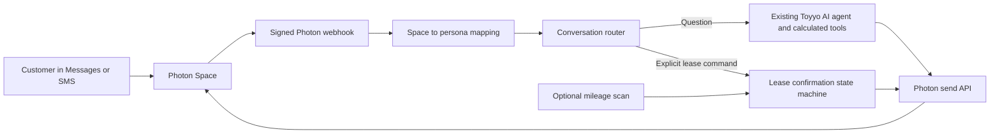

# Photon as the Toyyo conversation interface

## Goal and scope

A customer texts one Photon number to ask about their Toyota, lease, mileage, payments, and alternatives. Toyyo replies in that same conversation using the existing consent-aware dashboard, deterministic engines, and AI agent. A proactive mileage alert starts a conversation before an overage becomes expensive. The customer can review and explicitly confirm a simulated dealer packet by text. Dealer approval remains a separate demo action; a customer text cannot impersonate a dealer.

This is a synthetic hackathon prototype. It does not submit a real credit application, execute a contract, or change a real account. All numbers remain identified as estimates. The web dashboard remains a visual companion, while the message thread is the primary chat interface.

## System shape

Spectrum's **Space ID**, not message text or phone number supplied by the sender, selects a persona. A configured mapping connects each demo persona to one direct Space. An unknown Space receives no account data. The webhook verifies the signature before parsing the message. It ignores outbound messages, non-text content, and unrelated events. Inbound message IDs deduplicate retried deliveries within a running server instance. The current Spectrum SDK sender does not offer an outbound idempotency parameter.

## Conversation routing

1. For an ordinary question, collect the current persona's consented dashboard and up to the most recent few exchanges in that Space. Call the existing `runAgent` path. It can retrieve customer, trip, cash-flow, and calculated option data; its number-grounding check continues to apply. Send only the final checked text to Photon, split into short messages if needed. A missing model key uses the existing calculated fallback.
2. For `OPTIONS`, `SWITCH`, `BUYOUT`, `CONFIRM SWITCH`, `CONFIRM BUYOUT`, `STOP`, or `NO` during an active lease alert, use the deterministic lease workflow. A free-form question during that workflow goes to the agent without advancing the confirmation state.
3. `CONFIRM ...` is accepted only after that exact option was shown in the same conversation. It creates the simulated handoff packet. The model never calls this action on its own.
4. A customer message cannot approve the dealer packet. The current demo dealer approval control remains separate. On approval, the runtime car and contract update and Photon sends the estimated payment and first due date.
5. `STOP` ends an active workflow. Future proactive sends to that persona are suppressed until the demo is reset or the customer opts back in. Questions can still receive a reply.

## Proactive alert and data

The existing lease engine supplies the allowance, odometer, recent driving pace, and overage rate. At a projected excess of at least 1,000 miles, the workflow sends one warning, with updates only for material projection changes. The optional scheduler calls the scan endpoint after trip or odometer updates. The current dataset is a fixed synthetic snapshot, so no real vehicle or bank feed is implied. An explicit odometer update is available in the demo. A real deployment would replace this with authenticated data ingestion and durable storage.

Driving and banking consent are checked before those sources reach the model or packet. SMS replies do not include bank balances or VINs. The packet may include synthetic account fields only where current consent permits. Revoking driving consent prevents further mileage workflow replies. The existing dashboard and agent remain the source of option math; Photon transports messages only.

## Photon and app configuration

The project uses Stable Spectrum: a project id, a project secret, a connected iMessage line, and the webhook signing secret. There is no separate API key. Register `https://<public-host>/api/photon/webhook` for message events and copy the signing secret shown once at registration. `localhost` cannot receive an external webhook without a public HTTPS tunnel. A resolved `space.send()` means Spectrum accepted the message, not that the phone displayed it.

Server-only `.env` values:

| Variable | Purpose |
|---|---|
| `SPECTRUM_PROJECT_ID` | Public project UUID from Spectrum project settings |
| `SPECTRUM_PROJECT_SECRET` | Server credential from the same settings page |
| `SPECTRUM_WEBHOOK_SECRET` | Signing secret returned when the webhook is registered |
| `PHOTON_PERSONA_SPACES_JSON` | Required map from demo persona to a Spectrum Space id, e.g. `{"maya":"any;-;+15551234567"}` |
| `CRON_SECRET` | Bearer secret for the optional mileage scan endpoint |
| `LEASE_DEMO_SECRET` | Bearer secret for reading and mutating the simulated lease flow via `/api/lease-conversation` |
| `GEMINI_API_KEY` | Live AI replies with the Gemma 4 model via Google's Gemini API |
| `XAI_API_KEY`, `XAI_MODEL` | Optional Grok text-only fallback when Gemma fails; no tools or lease actions are available to this fallback |
| `AGENT_PROVIDER`, `ANTHROPIC_API_KEY` | Optional Anthropic alternative; without a model key, calculated fallback answers |

No key or phone number belongs in client code or a `NEXT_PUBLIC_` variable. Without a Space map, the webhook ignores inbound messages. For a single demo persona, `PHOTON_SPACE_ID` and `PHOTON_PERSONA_ID` can replace the JSON map.

## Inbound: streaming connection or webhook

Inbound messages arrive one of two ways (`lib/server/photon-stream.ts`, chosen at server start by `instrumentation.ts`):

- **Stream (default without a webhook secret).** The server keeps the Spectrum SDK's streaming connection open (`spectrum.messages`) and answers each inbound text from a mapped Space through the same `handlePhotonMessage` path as the webhook. It works on `localhost` with no tunnel and no webhook registration, but needs one long-running server process (`next dev` or `next start`), not serverless.
- **Webhook (when `SPECTRUM_WEBHOOK_SECRET` is set).** Spectrum POSTs signed events to `/api/photon/webhook`; this needs a public HTTPS URL registered in the Photon dashboard.

`SPECTRUM_INBOUND=stream|webhook|off` overrides the choice. Use one mode per deployment so a message isn't answered twice. The server logs `[photon] inbound mode: …` at start, and `[photon] inbound message …` / `reply sent …` per message.

The Photon CLI (`npx @photon-ai/cli`, binary `photon`) can confirm the setup: `photon whoami`, `photon projects list`, `photon spectrum users list` (the opted-in phone and the shared number it texts), `photon spectrum platforms list`, and `photon projects secret <id>` for `SPECTRUM_PROJECT_SECRET`. A direct-message Space id is `any;-;<E.164 phone>`.

## Reliability and boundaries

Spectrum can retry webhooks; process an inbound message ID at most once per running instance. Return an error if a send fails so the event can retry. The demo keeps conversation history and workflow state in server memory. This is sufficient for a single local/server instance but loses state on restart and cannot coordinate multiple instances. **A Vercel deployment may switch instances between texts, so the multi-message confirmation flow is not reliable there until durable storage is added.** Production needs a durable store and a queue before acknowledging webhooks, plus authenticated account linking, delivery-status tracking, and a real dealer integration.

Tests cover signature rejection, unknown Space rejection, normal question routing, command routing, duplicate delivery, consent, and the explicit confirmation boundary. Local smoke testing can use a signed sample webhook without sending a real phone message; a live end-to-end test requires the Photon settings above and a public URL.

Spectrum reference: https://photon.codes/docs/spectrum-ts/webhooks and https://photon.codes/docs/webhooks/verifying-signatures
