# Toyyo — Cinematic ownership experience

**Design specification · November 8, 2026 · v1**  
**Status:** design complete; implementation authorized, including a matching demo case study for every model.  
**Companion:** [Vehicle asset catalog](./VEHICLE_ASSET_CATALOG.md).

> **Revision, design review (November 8, 2026).** These changes supersede the sections below where they conflict.
> - **Your cars, not case studies.** The seven cars are presented as the visitor's own garage. The UI shows no driver names, avatars, cities or "story/case" language. The carousel label is a short descriptor (body style and contract, e.g. "Pickup · Loan") and "View details". The first tab is **Overview** (was Story): a car-first headline, a second-person summary, and the payment / odometer / months-left snapshot. Each car is still backed by one persona's data in the engines; that mapping stays internal (`personaId` in `lib/cinematic/vehicles.ts`).
> - **URLs:** `/cars/<car>/<section>`, default section `overview`. Old `/stories/<car>/<section>` links redirect (`story` → `overview`).
> - **Opening copy:** the headline reads "Your Toyyota"; the opening has no instruction line and no demo-disclosure link. The demo notice lives in About and in every car page's footnote ("Demo account · Illustrative figures, not an offer.").
> - **Carousel:** cars at 82% of the size the band allows; idle drift 18 px/s (below the 20–30 proposed in §3).
> - **Models:** authored materials and textures; the only change is each car's paint base colour (one material, colour factor only) so the seven cars differ; see [Model integration](./MODEL_INTEGRATION.md).
> - **Poses:** the carousel shows each car in a side three-quarter view (nose toward the drift); the selected car turns top-down as it moves left. Both poses are exported from `components/cinematic/stage-controller.ts` (`POSES`), and the posters are rendered from them (`scripts/models/render-posters.mjs`).
> - **Car page:** the car takes at most about a quarter of the screen; behind it a looping "driving world" (a country lane with grass, trees, rocks, bushes, a fence and wildflowers, vector-drawn into one repeating tile) scrolls under the car. Static under reduced motion. A scrim keeps the right side legible and arrives before the world during the opening.
> - **No card, a dashboard:** the tabs and ownership panel are replaced by a car-style dashboard filling the right side: odometer, tell-tale lights for alerts worth addressing (lease mileage, fuel vs. a typical 13,500 mi/yr, loan rate, payment timing, ToyotaCare, driving score; `lib/cinematic/alerts.ts`), and an icon-based monthly cost breakdown. The old panel files remain unused for future detail views.
> - **Repairs:** a Repairs control opens `/cars/<car>/repairs`: describe the issue → general guidance (likely part, urgency, repair vs. replace, cost range, worth fixing, warranty) → nearby shops with a bottom-right map (your location, shops, a star on the recommended one) or an explanation when none fits. Shops come from Mapbox Search (OpenStreetMap as fallback); neither has ratings, so recommendations are by fit and distance and each shop links to its reviews.

## 1. The experience

Toyyo opens as a cinematic collection of Toyota cars. Detailed 3D vehicles drift slowly across a nearly black stage, seen from slightly above. The cars occupy most of the screen. A visitor pauses on a car, sees it lift gently into focus, and selects it.

Everything around that car fades into black. The selected vehicle holds the viewer’s attention, then moves to the left and grows. A readable ownership story appears on the right. A vertical set of tabs at the far right changes the content: the story, finances, repairs, driving, the next move, and recommendations. The car remains present as the visual anchor throughout.

The opening should feel like entering a film; the ownership view should feel clear enough to actually use.

### Confirmed direction

| Decision | Requirement |
|---|---|
| Art direction | Cinematic black, off-white typography, restrained Toyota red accents |
| Landing page | One immersive opening screen; cars dominate; very limited copy |
| Camera | Slightly angled overhead, retaining an obvious top-down composition |
| Carousel | Continuous horizontal movement; pause and enlarge the hovered car |
| Selection | Selected car pops; surroundings fade to black; car enlarges and moves left |
| Ownership content | Scrollable right-hand content with persistent tabs at the far right |
| Models | Detailed, recognizable Toyota models only; exclude generic body-style substitutes |
| Toyyo mascot | Future feature attached visually to the car; gateway into contextual chat |
| Current deliverable | This design document, downloaded assets, and the full cinematic UI implementation with seven matching demo case studies |

The reference is [DID Global Cinema](https://www.dg-cinema.com/en) and the supplied screenshot. Carry over its scale, darkness, sparse interface, and flowing horizontal composition. Develop original typography, lighting, vehicle choreography, and layouts for Toyyo.

The exact copy, measurements, timings, and tab labels below are design proposals. They are concrete starting points for implementation, not additional decisions already made by the user.

## 2. Opening screen

### Composition

Use the full available viewport. At a 1440 × 900 reference size, reserve approximately 72 px for the header, 100–160 px for the title, 450–520 px for the car stage, and the remaining area for breathing room and small controls. Compress the title first on shorter screens so the cars remain whole.

```text
┌──────────────────────────────────────────────────────────────────────┐
│ TOYYO                                             About   Credits   │
│                                                                      │
│                        LIFE. IN DRIVE.                               │
│                                                                      │
│   partial car     CAR A        CAR B        CAR C     partial car     │
│                    ↖ slightly overhead / studio-lit ↗                │
│                                                                      │
│                       Camry · Maya’s story                            │
│                                                                      │
│ Choose a Toyota. Explore its story.             Pause       ←   →    │
└──────────────────────────────────────────────────────────────────────┘
```

This is a layout schematic; the actual vehicles are 3D models without rectangular cards or picture backgrounds.

- Small Toyyo wordmark at upper left. It is the home action everywhere.
- One oversized title, proposed copy **“LIFE. IN DRIVE.”** The model stage has greater visual weight than the headline.
- Three to four whole cars visible on a wide desktop, with neighboring cars partially visible at the edges. Seven unique vehicles form the proposed collection.
- A shallow arc in the presentation: a small vertical offset toward the edges and consistent vehicle orientation. Keep depth subtle enough to read as a horizontal carousel.
- Every car gets a compact identifying label; the hovered or focused car additionally reveals its driver/story label and an “Explore story” affordance. Identification must remain available on touch devices.
- One short instruction at the bottom. No marketing paragraphs, feature grids, financial summary widgets, or extra landing-page sections.
- A visible pause control and previous/next buttons. About and model credits open lightweight informational views and preserve carousel position on return.
- No autoplay audio. No loading screen that delays access to all navigation.

### Lighting and camera

Start approximately **15–25° away from directly overhead**. Keep the lens long enough to avoid stretched cars at the edges. All cars face the same direction. The visual target is a coherent studio shoot, even though different artists created the assets.

A broad soft key light reveals the roof and bodywork; a quieter rim light separates dark paint from the background. Soft contact shadows establish depth. Prefer restrained reflections, preserve readable glass and wheels, and avoid a bright reflective floor or a modeled showroom environment.

Car paint provides variety. Proposed palette: deep red, pearl white, steel blue, silver, and muted green. Recolor only verified body-paint materials. Some source files bake paint into textures, so keep their authored finish until recoloring has been visually checked.

## 3. Carousel interaction

### Idle

The collection drifts right-to-left at a constant, calm pace: start with **20–30 CSS pixels per second** on desktop, then tune by observation. It loops seamlessly without visibly reversing or jumping. There is no automatic selection or timed page navigation.

### Hover and keyboard focus

Pause the whole track immediately when a car receives pointer hover or keyboard focus. Enlarge that car approximately **6–8%** over 200–250 ms, raise it slightly above its resting position, and strengthen its key light. Neighboring cars stay stable. Keep the car’s hit area continuous through the animation to avoid hover flicker.

The active label becomes fully legible and its explore arrow appears. Keyboard focus gets a visible outline on a corresponding DOM control. Focus and hover convey the same information.

Resume gently after the pointer leaves the track and keyboard focus has left the carousel, unless the visitor explicitly paused it. Manual pause takes precedence over every automatic resume condition.

### Manual navigation

Previous/next controls advance one car and pause autoplay. Desktop dragging and touch swiping move the collection directly; after a manual gesture, leave it paused until the visitor resumes. Distinguish a drag from a tap before opening a story.

Scrolling the wheel should not unexpectedly change cars. Keyboard arrows move within the carousel; Enter opens the focused car. Off-screen clone elements are never separate keyboard stops or repeated screen-reader entries.

## 4. The defining transition

The same selected 3D object persists from the carousel into its ownership view. It should never disappear and be replaced by another canvas halfway through the transition.

| Time from selection | Visual behavior | Interaction behavior |
|---|---|---|
| 0–180 ms | Freeze the track; selected car lifts and grows roughly 10–12% from its resting size | Accept one selection; repeated taps do not queue transitions |
| 100–420 ms | Title, controls, labels, other cars, and ground treatment fade toward black | Keep the selected car and its lighting visible |
| 300–900 ms | Car travels to the left and grows to its ownership-view size; camera eases into a more revealing overhead three-quarter angle | Prefetch story content; retain a working Back action |
| 700–1100 ms | Story heading and text enter from 16–24 px below at low stagger; tab rail appears | Move focus to the story heading once ready |
| After settling | Car remains stable on the left; right content scrolls independently | Enable the complete ownership interface |

Timings overlap. Target approximately **1.0–1.2 seconds total**, with the selected car continuously visible. Use a controlled ease-out; avoid elastic overshoot, spinning, strong blur, or a long black interstitial.

The car may turn gently during its move so the side, hood, and front become more visible. It must retain a recognizable connection to the overhead starting view.

Back reverses the spatial idea in approximately 600–800 ms: content fades, the car returns to its saved place, and the collection reappears. Restore the prior carousel position, explicit pause state, and focus. Browser Back must work as well as the on-screen “All cars” action.

```mermaid
stateDiagram-v2
    [*] --> Carousel
    Carousel --> Focused: Hover or keyboard focus
    Focused --> Carousel: Leave, unless manually paused
    Carousel --> Isolating: Select car
    Focused --> Isolating: Select car
    Isolating --> MovingLeft: Surroundings fade
    MovingLeft --> Story: Car settles; content enters
    Story --> OwnershipTab: Choose right-side tab
    OwnershipTab --> OwnershipTab: Change tab
    OwnershipTab --> Story: Choose Story
    Story --> Returning: All cars or browser Back
    OwnershipTab --> Returning: All cars or browser Back
    Returning --> Carousel: Restore saved position
```



**Reduced motion:** stop autoplay by default; replace spatial travel with a brief opacity change or immediate layout change. All information and controls stay available. A paused or reduced-motion state must never leave content invisible.

## 5. Ownership view

### Desktop structure

```text
┌──────────────────────────────────────────────────────────────────────┐
│ TOYYO    ← All cars                                     CASE 01 / 07 │
│                                                                      │
│                                                ┌─────────────────┐  │
│                          Maya’s Camry           │ 01  Story       │  │
│       LARGE CAR          A lease decision       │ 02  Finances    │  │
│       persistent         approaching.           │ 03  Repairs     │  │
│       studio stage                              │ 04  Driving     │  │
│                          Overview and details   │ 05  Next move   │  │
│      [future Toyyo]      scroll in this column  │ 06  Recommend.  │  │
│                          ↓                      └─────────────────┘  │
│                                                                      │
└──────────────────────────────────────────────────────────────────────┘
```

Allocate approximately **45% to the car, 43% to readable content, and 12% to the tab rail**. At desktop widths, target a 480–620 px reading column with 24–40 px separation from the tabs. Use a 48–64 px outer gutter where space allows. Keep the car whole, including its mirrors and wheels.

The car and tab rail remain stationary while the content column scrolls. The content panel has its own visible, restrained scrollbar; users may scroll while the pointer is over that panel. The car area does not trap wheel or touch events.

The vertical tabs are **a vertically stacked list with horizontal, readable labels**. This is the proposed interpretation of “vertical tabs.” Rotated text is unnecessary. Active state: a slim red marker, off-white label, and optional small number. Inactive state: muted text that still meets contrast requirements. Hit areas remain at least 44 px high.

### Content hierarchy

Each tab opens with one clear heading and a one-sentence summary. Place the main decision or metric next, followed by supporting details and actions. Favor readable rows, strong numbers, and restrained dividers over a wall of dashboard cards.

| Tab | Purpose | Initial content and behavior |
|---|---|---|
| **Story** | Introduce the driver and their situation | Name, vehicle, city, a short situation narrative, ownership snapshot, and links to the relevant ownership sections |
| **Finances** | Explain the lease or loan | Monthly payment, time remaining, balance or residual value, APR where relevant, insurance cost, and clearly labeled scenario controls |
| **Repairs** | Understand upkeep and repair choices | Maintenance context, available coverage information, a repair concern entry point, estimated choices with their assumptions, and any supported next action |
| **Driving** | Explain patterns behind decisions | Mileage trend, driving score where consent allows, major score factors, trip summaries, and an explicit trip replay action |
| **Next move** | Compare the driver’s meaningful choices | Options relevant to that person: lease return, buyout, refinance, payment adjustment, or coverage; compare cost, timing, and tradeoffs |
| **Recommendations** | Bring the strongest relevant suggestion forward | Ranked recommendation, why it fits, assumptions and supporting data, alternatives, and existing supported accept/dismiss flows |

“Next move” is the comparison workspace. “Recommendations” is the prioritized shortlist. This distinction prevents two nearly identical tabs.

Switching tabs fades the old content out and introduces the new content over approximately 180–250 ms. Keep the car stable by default. Repairs may later use a controlled camera emphasis when the visitor chooses a specific component, but ordinary tab changes should not repeatedly animate the vehicle.

Preserve each tab’s scroll position within the current case study. New cases begin at the top of Story. Keep a stable content width so headings and figures do not shift while data loads.

### Routing and behavior

Proposed shareable URLs: `/stories/[vehicle]/[section]`, with Story as the default section. A refresh or direct link opens the settled ownership layout; it does not pretend the visitor clicked from a carousel that was never shown. Invalid stories and sections receive a useful not-found state and a link to all cars.

The URL is authoritative for the selected story and section. Retain session-local carousel position for return navigation. Tab changes need a consistent history policy: use replacement navigation for ordinary tab browsing so Back returns to the carousel in one step; direct links still encode the selected tab.

The content is DOM text and controls over a 3D stage. It stays selectable, searchable, accessible, and usable if WebGL fails.

## 6. Toyyo mascot and chat — planned later

Reserve a small anchor near the selected car’s roof or hood for Toyyo. The mascot should feel associated with the vehicle without obscuring its silhouette. Exact character design, scale, rig, and attachment point remain to be designed.

The intended behavior is simple: activate Toyyo to open contextual chat within the **right content area**, retaining the car and navigation. Include a nearby accessible “Ask Toyyo” control; clicking a tiny animated character cannot be the only way to reach chat.

Carry the current case study, tab, and optional selected recommendation into chat. Do not expose information whose consent has been disabled. Closing chat restores the prior section and its scroll position. On mobile, chat becomes a full-height sheet above the current story.

Mascot idling should be subtle and motion-aware. No unsolicited speech bubble, interruptions, or repeated attention-seeking animation. Reserve the space in the first rebuild; character production and chat choreography belong to a later phase.

## 7. Visual system

| Element | Proposed direction |
|---|---|
| Opening ground | Near black, approximately `#090909` |
| Selected-car isolation | Black, `#000000` |
| Main text | Warm off-white, approximately `#F2F0EB` |
| Supporting text | Neutral gray, approximately `#A5A5A2` |
| Brand accent | Toyota red, approximately `#EB0A1E`, used for active markers and selected actions |
| Display typography | Bold condensed sans serif; uppercase on the opening title only |
| Interface typography | Existing Overpass family for readable body text and numbers; evaluate a separate condensed display face during mockup |
| Body sizing | 16–18 px; roughly 1.5–1.65 line height; 50–70 characters per line |
| Headings | Large opening title; 40–64 px ownership headings; clear smaller section headings |
| Controls | Quiet outlined or text controls; small corner radius; one consistent primary-action treatment |
| Surface treatment | Predominantly open black space; restrained panel surfaces only where grouping helps |
| Motion | Calm drift, responsive hover, one expressive selection transition, quiet content transitions |

Voice: concise, practical, and personal. The opening invites exploration; the ownership view explains actual choices. Monetary values, estimates, and mock data must be labeled accurately. Keep a small “Demo case studies” disclosure available without crowding the opening screen.

## 8. Mobile and smaller screens

**Wide desktop, 1200 px and above:** the full car/content/tab layout. Three to four complete carousel cars may be visible depending on aspect ratio.

**Tablet, approximately 768–1199 px:** reduce the headline and gutters; show two or three carousel cars. Keep the split ownership view only while the reading column remains at least about 360 px wide. Below that threshold, stack the layout.

**Phone:** one dominant car with partial neighbors; swipe and visible previous/next controls. Autoplay is off by default on coarse-pointer devices. Tap selects directly; there is no hover-only first step. Keep the opening screen immersive without forcing tiny cars to fit beside all seven labels.

For the selected view, the car first isolates, then settles into a compact upper stage. Content flows underneath, and the six sections become a horizontally scrollable tab strip with readable text. The tab strip may stick beneath the compact header; let the large car stage scroll away on short screens to preserve reading space. Use normal page scrolling rather than a second small scroll container inside the page.

Maintain access to all sections, the All cars action, and future chat at 320 px width and at 200% text zoom. On-screen keyboards must not cover form actions. Landscape phones follow the same content-first constraints rather than reproducing desktop proportions literally.

## 9. Models, stories, and source integrity

The proposed collection contains the two existing detailed models and five newly downloaded vehicle-specific models. The five additions total **10,326,628 bytes, approximately 9.85 MiB**. They are staged in `public/models/cinematic/` and are **not yet referenced by the live application**.

| Vehicle | Asset status | Case-study status (final) |
|---|---|---|
| Camry Hybrid | Existing detailed 2025 model | **Ryan**, Richardson TX (hackathon pack customer C010). 2025 Camry XSE lease, 18 months left, $435/month, relocating to Denver. Best move (pack golden answer, Follow-up): keep the lease and move it to Colorado; ending early would cost about $3,135. |
| GR Supra | Existing detailed model | **Jordan**, Houston. 2024 GR Supra loan; data already matched the asset. Best move: insurance coaching, then payment timing. |
| RAV4 Hybrid | Downloaded detailed model (XA50 generation, 2019-2025) | **Devon**, Dallas (pack customer C006). 2024 RAV4 Hybrid XSE lease, 5 months left, about 24,000 of 36,000 miles used. Best move (pack golden answer, Offer): early lease renewal into a new hybrid; buyout and return are the compared alternatives. |
| Land Cruiser J200 | Downloaded detailed 2017 model | **Nora**, Boerne, Texas. Used 2017 Land Cruiser loan, 52 payments left. Best move: refinance, then service coverage for an older vehicle. |
| Hilux | Downloaded detailed 2007 model | **Eli**, San Juan, Puerto Rico. 2007 Hilux used-vehicle loan, 27 payments left, simulated local insurer. Best move: refinance, with extra principal as the payoff plan. |
| Corolla Cross | Downloaded vehicle-specific model | **Priya**, Plano TX (pack customer C003). 2024 Corolla Cross LE lease, 3 months left, on pace for 49,500 of 36,000 miles. Best move (pack golden answer, Offer): compare buying with returning (return about $3,770, buyout $16,670 for a car worth about $18,600), then decide inside the 90-day window. |
| GR Yaris | Downloaded textured vehicle-specific model | **Theo**, Fort Worth. 2020 GR Yaris loan, 47 payments left, autopay on, score 78. Best move: insurance coaching. |
| Tacoma (not in carousel) | No detailed Tacoma model | **Raj**'s 2021 Tacoma lease case stays in the data and APIs but has no carousel car until a detailed Tacoma model is added. |

**Case source (data pack).** Three cars use customers from the UTD "Smartest Next Move" synthetic data pack (supplied as-is in `data/pack/`): Camry to Ryan (C010), RAV4 Hybrid to Devon (C006), Corolla Cross to Priya (C003). Their case files (`data/cases/<id>.json`) copy the pack's golden best next move and option rows verbatim. The other four cars (GR Supra to Jordan, Land Cruiser to Nora, Hilux to Eli, GR Yaris to Theo) keep Toyyo-authored cases written in the same shape. Maya, the Garcias, Ava and Raj stay in the data and tests but are not in the carousel. Every case file carries a `source` ("pack" or "toyyo"), the driver's own-words `quote`, a one-line `context`, the best move with its next-step type (Self-service, Follow-up or Offer), and `notes`. `GET /api/persona/[id]` returns it as `caseFile`; `lib/cinematic/cases.ts` exports a client-safe summary per car. The car `summary` copy stays car-centric and second person; driver names belong in the case UI.

**Assumptions added for the pack personas** (not in the pack, and each also recorded in the case file `notes`): MPG is an approximate EPA combined figure (Camry hybrid 44, RAV4 Hybrid 40, Corolla Cross 32). Insurance is a simulated premium with a "(simulated)" carrier, and insurer-sharing consent is off. Toyota Care start is the pack end date minus 24 months. Average balance is a simulated 40% of monthly income; Ryan's payday (day 30) maps to the closest cash-flow pattern, monthly. Overage $0.25 per mile, disposition fee $395 and purchase option fee $350 are the pack's stated assumptions, and the annual allowance is the pack's total allowance divided by the term in years. The pack clock is 2026-11-07 and Toyyo's is 2026-10-27, so the pack's months remaining are kept as supplied. The 90-day drive history is synthetic on genuine OSRM routes and calibrated so monthly miles equal the pack's annual miles estimate divided by 12. Our lease-end engine adds 6.25% Texas sales tax to the buyout, which the pack ignores, so engine buyout totals are slightly higher than the pack rows; the engine's return invoice matches the pack's RETURN option exactly for all three. The engine still ranks a lease-end buyout first for all three, while the case file shows the pack's golden move (Ryan's relocation move has no engine equivalent). Pack personas carry a `profile` (vulnerable flag, marketing consent, preferred channel, stress score) so the copilot can follow the pack's responsible-AI rules: vulnerable or two or more missed payments means a person, with no upsell; no marketing without consent.

**Market disclosures.** All prices, rates, insurers and values are simulated US dollars. The Hilux was not sold new in the US, so Eli is placed in Puerto Rico, where a Toyota dealer marketed the Hilux in 2024 (a 2007 sale there is not confirmed, so his truck is simply an older Hilux). The Corolla Cross reached the US for model year 2022, so Ava's car is a 2025 model. The GR Yaris was never sold in the US, so Theo's case is a fictional US-dollar scenario, as if the car were available here.

The new RAV4 is eligible because it is a real RAV4 model, replacing the need for the simple SUV stand-in. The generic sedan, SUV, rugged SUV, and truck models are excluded from the redesigned carousel. The Tacoma story is excluded until a suitable actual Tacoma asset is obtained. Do not delete shared fallback files during this planning pass because the existing app still references them; remove their use from the new experience during implementation.

Every asset without a case study must receive a new matching fictional case study during implementation. These cases must have consistent vehicle identity, narrative, financial figures, driving data, maintenance context, and recommendations. No car is included merely to fill space. Each model also needs an in-app inspection from the actual overhead and enlarged angles, correct orientation and scale, and material checks. The GR Yaris uses fewer polygons with textured detail; assess it at the enlarged viewing size before final inclusion.

All five new models have source listings specifying **CC BY 4.0**, verified through the public Sketchfab metadata API on November 8, 2026. Preserve author attribution, source and license links, and the upstream modification notice. The existing Camry and Supra manifest records specify **CC BY-NC-SA 4.0** and **CC BY-NC 4.0**, respectively; do not describe the combined seven-car collection as commercially cleared. [Asset catalog and credits](./VEHICLE_ASSET_CATALOG.md).

Suggested future story themes: everyday commuting, a growing family, managing a performance-car budget, long-distance ownership, maintaining an older pickup, first-time ownership, and an enthusiast’s daily driver. These are editorial proposals; they are not existing customer records or claims about the downloaded cars.

## 10. Technical shape and performance targets

Preserve useful data engines, APIs, consent behavior, and existing ownership actions while rebuilding the presentation. The old dashboard shell should not wrap the cinematic landing page. Use a dedicated experience layout that owns the persistent stage, content panel, and navigation.

Proposed implementation responsibilities:

- **Experience shell:** selected story, current section, transitions, viewport mode, and URL synchronization.
- **Vehicle stage:** a single persistent WebGL canvas, studio lighting, camera poses, model loading, and resource cleanup.
- **Carousel controller:** time-based drift, pause reasons, hover/focus, drag/swipe, and stable restore position.
- **Story panel:** accessible, scrollable DOM content backed by the existing data layer.
- **Section navigation:** responsive right-side rail or mobile strip.
- **Asset registry:** vehicle identity, file, scale/orientation, verified paint mapping, credits, preview, and availability.
- **Future assistant anchor:** the eventual mascot position and accessible chat entry point.

Model loading must understand the new assets’ Meshopt compression as well as the existing models’ Draco compression. Avoid using one WebGL canvas per car. Cache and reuse geometry; render visible cars and a small neighboring buffer. Unload unnecessary detail when memory pressure requires it.

Performance targets are provisional, not measured results: aim for 60 fps desktop animation and stable 30 fps on a representative phone; clamp device pixel ratio around 1–1.5 where needed. Reduce shadows and expensive effects before sacrificing model silhouettes or readable UI.

Create carousel-quality and selected-view-quality variants as needed. The Hilux currently has about 259k triangles and the Land Cruiser has 37 materials; geometry and draw-call cost require profiling even though their downloads are small. The existing Camry is about 14 MiB and needs its own loading strategy. Do not load every model at its highest detail before first paint.

Show a real rendered poster for each model while its 3D asset loads. The poster must depict that exact model. After an error, retain the poster and a working story link with a retry action; do not silently substitute a generic car. Keep data accessible if WebGL is unavailable or its context is lost.

## 11. Edge cases and accessibility

| Situation | Required behavior |
|---|---|
| Model fails to load | Exact-model poster, concise error/retry, accessible case-study entry |
| Story data fails | Car stays visible; content presents retry and All cars controls |
| Slow case-study response | Transition settles; stable panel skeleton; no indefinite dark screen |
| New selection during transition | One transition owns the state; repeated clicks cannot mix vehicles and data |
| Back during transition | Cancel safely and restore the prior collection state |
| Resize or orientation change | Recalculate the target pose; keep the selected car and active tab |
| Browser tab hidden | Pause motion and rendering where possible; resume without a large time jump |
| No driving/banking consent | Clearly explain unavailable detail and respect the existing consent controls |
| Long tab content | Scroll without moving or obscuring the desktop car and tab rail |
| Keyboard navigation | Logical order, visible focus, labeled controls, accessible story links and tabs |
| Reduced motion | Static carousel by default; immediate or short-fade transitions |
| Informational dialog | Correct focus management, Escape closes, restore focus and paused state |

Use DOM controls corresponding to the 3D cars. Expose each unique case once to assistive technology. For in-place tabs, implement tablist/tab/tabpanel semantics with arrow-key navigation; if navigation is rendered as ordinary links, use correct link semantics and `aria-current` instead. Maintain contrast and do not use red alone to signal active state.

Financial actions retain their existing confirmations and disclosures. A visual rebuild must not turn a comparison or estimate into an executed action.

## 12. Implementation sequence and acceptance

1. **Asset and story alignment:** inspect all seven cars under one light rig; normalize orientation and scale; establish paint mappings; create exact-model posters; reconcile model years and author matching synthetic case data.
2. **Opening experience:** build the single-screen layout and continuous 3D carousel, including hover, focus, pause, touch, and reduced-motion behavior.
3. **Selection choreography:** implement isolation, leftward travel, enlargement, content entrance, cancellation, and return. Test this with two cars before expanding to the whole collection.
4. **Ownership workspace:** build the scrollable panel and right tab rail; connect Story, Finances, Repairs, Driving, Next move, and Recommendations to the appropriate data and actions.
5. **Responsive and reliability pass:** test mobile layout, direct URLs, browser history, loading failures, missing consent, keyboard access, zoom, and render performance.
6. **Later:** design and integrate the Toyyo mascot and contextual chat transition.

The first rebuilt experience is ready for review when:

- The opening is a single immersive viewport with cars as the dominant element.
- Every selectable car is a detailed model with a matching case study and source attribution.
- Hover and keyboard focus pause the carousel and gently enlarge the target; explicit pause stays respected.
- Selection keeps the same car visible throughout the black-background transition and leftward movement.
- Desktop content scrolls independently while the car and vertical tab rail remain stable.
- Every tab shows the correct selected driver’s information; case changes cannot leak the previous driver’s state.
- Back returns to the saved carousel position, and direct story URLs work on reload.
- Mobile supports swipe, tap, all sections, and readable content without horizontal page overflow.
- Reduced motion, keyboard navigation, data errors, and WebGL failures all retain a useful experience.
- The actual device tests meet agreed performance targets; visual fidelity is reviewed at both carousel and enlarged scales.

### This planning pass delivered

This specification, five downloaded GLB files, source previews, author/license records, checksums, and structural model-validation results. No routes, components, current persona data, or live model manifest were changed. The assets have been decoded and their source previews inspected; runtime lighting, paint mapping, mobile performance, and the proposed UI remain implementation work.
