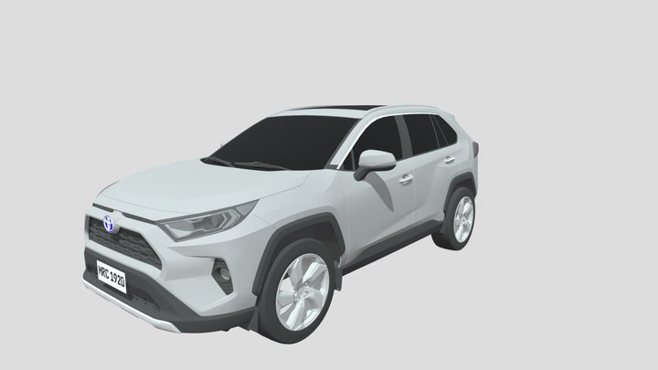
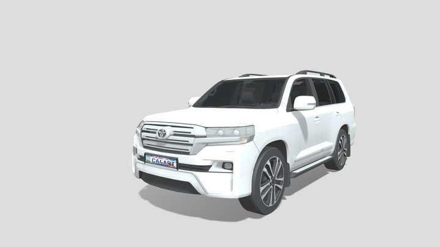
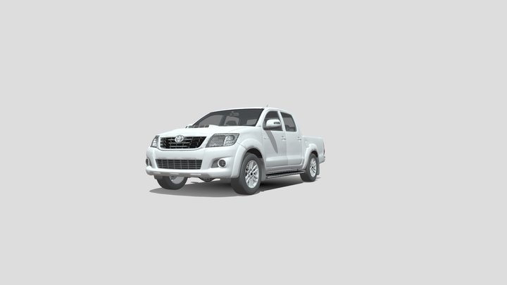
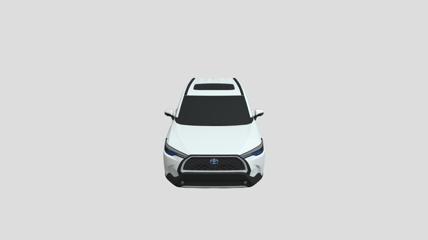
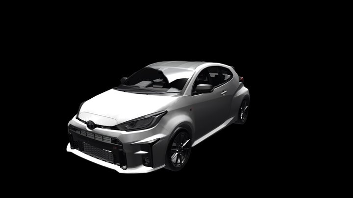

# Toyyo — Vehicle asset catalog

Downloaded November 8, 2026. Five vehicle-specific GLB models are staged for the proposed cinematic experience. They are wired into the carousel registry (`lib/cinematic/vehicles.ts`); case-study data is owned separately.

## Collection

| Vehicle | Local GLB | Download | Triangles in downloaded geometry | Author |
|---|---|---:|---:|---|
| 2021 Toyota RAV4 Hybrid | [toyota-rav4.glb](../../public/models/cinematic/toyota-rav4.glb) | 2.81 MiB | 168,940 | [tonielpro520](https://sketchfab.com/tonielpro520) |
| Toyota Land Cruiser J200 2017 | [toyota-land-cruiser.glb](../../public/models/cinematic/toyota-land-cruiser.glb) | 2.97 MiB | 117,273 | [David_Holiday](https://sketchfab.com/David_Holiday) |
| Toyota Hilux 2007 | [toyota-hilux.glb](../../public/models/cinematic/toyota-hilux.glb) | 1.96 MiB | 259,220 | [David_Holiday](https://sketchfab.com/David_Holiday) |
| Toyota Corolla Cross | [toyota-corolla-cross.glb](../../public/models/cinematic/toyota-corolla-cross.glb) | 0.86 MiB | 168,266 | [Nieve5677](https://sketchfab.com/niev) |
| 2020 Toyota GR Yaris | [toyota-yaris.glb](../../public/models/cinematic/toyota-yaris.glb) | 1.24 MiB | 12,562 | [DisneyCars](https://sketchfab.com/supercarmodels) |

Total: 10,326,628 bytes (9.85 MiB). Existing Camry and GR Supra files remain in `public/models/`.

## Source and attribution

All five original listings report **CC BY 4.0**, verified through the public Sketchfab model metadata API on the download date. Preserve the author, model source, license link, and modification notice when displaying or redistributing these assets. The downloaded files came from [pedrosoandre/carros](https://github.com/pedrosoandre/carros) at commit `2d18dfd9db96bbf0d9cffa949deaf7f571388cbf`. The upstream collection reports geometry welding, simplification, pruning, and Meshopt compression; Toyyo has not modified the downloaded GLB bytes. See its [processing and licensing record](https://github.com/pedrosoandre/carros/blob/2d18dfd9db96bbf0d9cffa949deaf7f571388cbf/LICENSE-3D-MODELS.md).

The existing Camry is recorded as CC BY-NC-SA 4.0 and GR Supra as CC BY-NC 4.0 in the project manifest. Those restrictions still apply; the seven-car collection does not have a uniform commercial-use license.

## Source previews

These are previews from the original model listings, credited to their respective model authors below. They are reference images, not renders of the proposed Toyyo lighting or overhead composition.

### 2021 Toyota RAV4 Hybrid

[2021 Toyota RAV4 Hybrid](https://sketchfab.com/3d-models/2021-toyota-rav4-hybrid-de74fe4e98004c92b1103947597d1b53) by [tonielpro520](https://sketchfab.com/tonielpro520), licensed under [CC BY 4.0](https://creativecommons.org/licenses/by/4.0/). [Downloaded GLB](https://raw.githubusercontent.com/pedrosoandre/carros/2d18dfd9db96bbf0d9cffa949deaf7f571388cbf/assets/toyota-rav4.glb).

SHA-256: `7bd7659f11807c257c4f0d6ca017c53fd59e0dbc73c294b1381353b3f86154bf`.

### Toyota Land Cruiser J200 2017

[Toyota Land Cruiser J200 2017](https://sketchfab.com/3d-models/toyota-land-cruiser-j200-2017-374e85a6e18743429f6d9c0e7bbffb3c) by [David_Holiday](https://sketchfab.com/David_Holiday), licensed under [CC BY 4.0](https://creativecommons.org/licenses/by/4.0/). [Downloaded GLB](https://raw.githubusercontent.com/pedrosoandre/carros/2d18dfd9db96bbf0d9cffa949deaf7f571388cbf/assets/toyota-land-cruiser.glb).

SHA-256: `5af0befd64927eac496f8f4bd0a888d011f84db728cf5da3815fa3c3e05c992a`.

### Toyota Hilux 2007

[Toyota Hilux 2007](https://sketchfab.com/3d-models/toyota-hilux-2007-0234ebed01ee4b87affed0e58673247e) by [David_Holiday](https://sketchfab.com/David_Holiday), licensed under [CC BY 4.0](https://creativecommons.org/licenses/by/4.0/). [Downloaded GLB](https://raw.githubusercontent.com/pedrosoandre/carros/2d18dfd9db96bbf0d9cffa949deaf7f571388cbf/assets/toyota-hilux.glb).

SHA-256: `231a8262217c1a16483d1558a79f2811ecec35d4cd0dc7ace959e4710db81c92`.

### Toyota Corolla Cross

[Toyota Corolla Cross](https://sketchfab.com/3d-models/toyota-corolla-cross-cc503d26ea694dce85e7d0f1491b0e30) by [Nieve5677](https://sketchfab.com/niev), licensed under [CC BY 4.0](https://creativecommons.org/licenses/by/4.0/). [Downloaded GLB](https://raw.githubusercontent.com/pedrosoandre/carros/2d18dfd9db96bbf0d9cffa949deaf7f571388cbf/assets/toyota-corolla-cross.glb).

SHA-256: `bbafded5432913132a62211f3a564de4a54f9a12caf5bc634029b0e51acb8873`.

### 2020 Toyota GR Yaris

[2020 Toyota GR Yaris](https://sketchfab.com/3d-models/2020-toyota-gr-yaris-44cb958908b94aa5aad0d856994f35a3) by [DisneyCars](https://sketchfab.com/supercarmodels), licensed under [CC BY 4.0](https://creativecommons.org/licenses/by/4.0/). [Downloaded GLB](https://raw.githubusercontent.com/pedrosoandre/carros/2d18dfd9db96bbf0d9cffa949deaf7f571388cbf/assets/toyota-yaris.glb).

SHA-256: `72950d75629e230a5ed96f0bd0a995888c3a0ab6cc75729e2b64520628b2171f`.

## Verification and integration notes

- All five files have valid GLB v2 headers and declared file lengths matching the downloaded bytes.
- All five decode successfully with glTF Transform and Meshopt. The decoded scenes contain meshes and materials, finite position values, and no missing image payloads or external buffers.
- Source previews were visually inspected. All seven models were later rendered at the overhead, carousel and selected angles (see MODEL_INTEGRATION.md, Visual review): noses, lengths, floor contact and paint materials are verified.
- The models require `EXT_meshopt_compression` and `KHR_mesh_quantization`; configure a compatible loader.
- The RAV4 source catalog suggests `BlackTrim` as its paint material; rendering confirmed `Silver_Sky_Metallic` is the real body paint and `BlackTrim` is trim.
- The Land Cruiser file includes a stray ground plane (`material_0`), which the stage drops; the GR Yaris needs `rotationY: 180`.
- Normalize each model’s dimensions, center, floor contact, and nose orientation. Do not infer those from the filename.
- The Hilux has 259,220 triangles and 44 materials; the Land Cruiser has 37 materials. Profile their draw calls and create lower-cost carousel variants as needed.
- The GR Yaris has 12,562 triangles and eight textures. It is a recognizable textured vehicle model, but enlarged close-up quality remains a visual acceptance check.
- The existing generic sedan/SUV/truck files are excluded from the redesigned collection. They remain physically present because existing screens still reference them; removing those runtime dependencies belongs to implementation.
- New vehicles require matching fictional ownership data. Do not reuse a different vehicle’s loan or lease as if it belonged to the downloaded model.

Machine-readable records: [sources.json](../../public/models/cinematic/sources.json) and [validation.json](../../public/models/cinematic/validation.json).

## Final carousel files (original, unmodified GLBs, November 8, 2026)

| Vehicle | File used by the carousel | Bytes | Poster |
|---|---|---:|---|
| Camry XV80 Hybrid | `public/models/camry.glb` (original, 14 MB) | 14,769,368 | `posters/camry.png` |
| RAV4 Hybrid | `public/models/cinematic/toyota-rav4.glb` | 2,946,512 | `posters/rav4.png` |
| GR Supra | `public/models/gr-supra.glb` | 2,896,936 | `posters/gr-supra.png` |
| Land Cruiser J200 | `public/models/cinematic/toyota-land-cruiser.glb` | 3,117,348 | `posters/land-cruiser.png` |
| Hilux | `public/models/cinematic/toyota-hilux.glb` | 2,054,816 | `posters/hilux.png` |
| Corolla Cross | `public/models/cinematic/toyota-corolla-cross.glb` | 902,568 | `posters/corolla-cross.png` |
| GR Yaris | `public/models/cinematic/toyota-yaris.glb` | 1,305,384 | `posters/gr-yaris.png` |

Models total 27,992,932 B (26.7 MiB); the 14 MB Camry is the bulk. Materials and textures are rendered as authored; only each body-paint material's base colour factor is tinted (see MODEL_INTEGRATION.md, Paint colours). The only scene edit is dropping the Land Cruiser's stray ground plane at load time; the files on disk are unmodified. Credits and licenses above and in `public/models/cinematic/sources.json` are unchanged. Posters are renders of the credited models and carry the same licenses and attribution.
